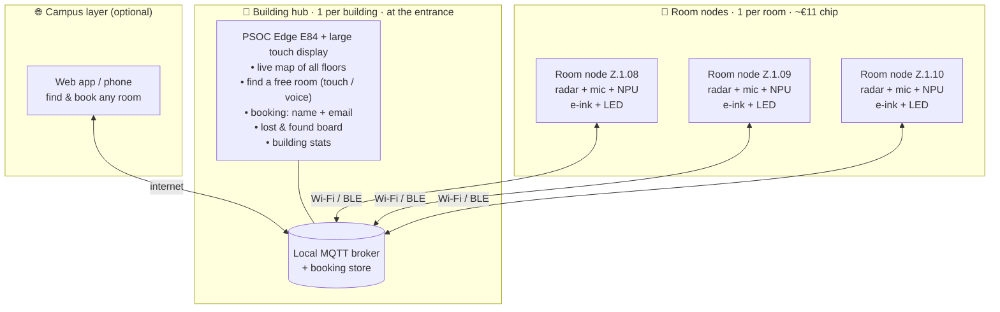
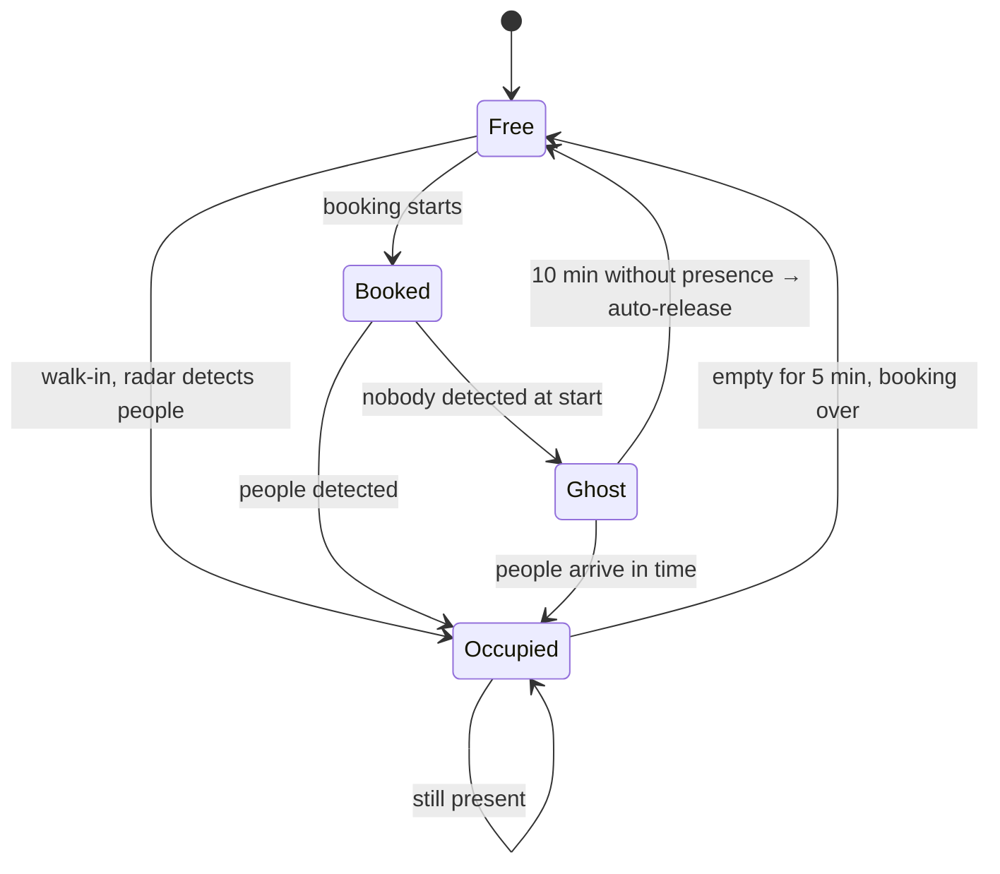
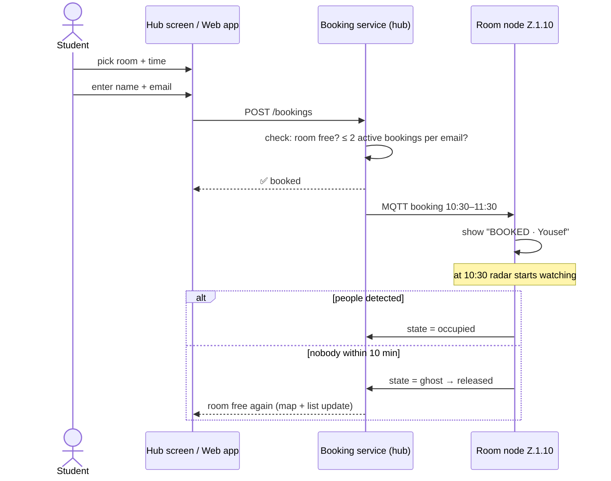
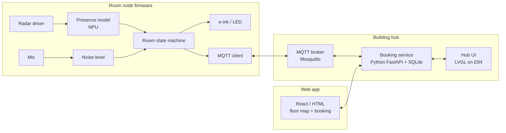
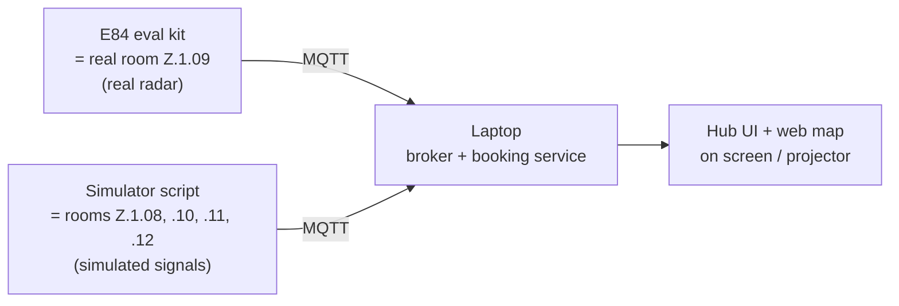

# InhabitX — Smart Campus Room Assistant

> **Challenge 01 · Infineon · campus_compile**
> Every room senses for itself on an ~€11 chip. One hub per building turns that into a live map nobody has to manage.

---

## 1. The problem

Students and staff struggle to find free rooms, and rooms sit empty behind **ghost bookings**: booked, but nobody shows up. Lost items pile up with no record of where they were left.

## 2. The idea in one sentence

A **PSOC™ Edge E84 node in every room** detects presence with radar on the device. Booked rooms that stay empty **release themselves**, and a **building hub** plus a **web app** show every room's live status and let anyone book in 10 seconds with just a name and email.

---

## 3. System architecture



| Layer | Device | Senses | Decides | Shows |
|---|---|---|---|---|
| **Room node** | E84 + radar + mic, e-ink or LED | presence, ~people count, noise | occupied / empty / ghost booking | room status, release countdown |
| **Building hub** | E84 + touch display | none | releases rooms, enforces booking rules | floor map, free-room finder, booking, lost & found |
| **Web app** | phone / laptop | none | none | same booking features, from anywhere |

**Design principles**
- **Privacy:** no cameras. Rooms send only *states* (`occupied, 3 people`), never raw sensor data.
- **Edge first:** each room decides on the device. The building keeps working if the internet drops.
- **No accounts:** booking takes a name + email. The room itself checks whether you showed up.

---

## 4. Room lifecycle



**Room-node logic (on the E84):**

```text
present  = radar_presence debounced over ~30 s
occupied = present
ghost    = booked AND NOT present for > 10 min after start  → release
```

### A ghost booking, minute by minute

```mermaid
gantt
    title Room Z.1.09 · booked 10:00 – 11:00, nobody comes
    dateFormat HH:mm
    axisFormat %H:%M
    section Booking
    Booked by Sam K.            :done,   b1, 10:00, 10m
    Released → free             :active, b2, 10:10, 50m
    section Radar
    No presence detected        :crit,   r1, 10:00, 10m
    Walk-in group detected      :        r2, 10:14, 46m
    section Screens
    Countdown on door + hub     :crit,   s1, 10:00, 10m
    Shown as FREE everywhere    :        s2, 10:10, 4m
    Shown as OCCUPIED           :        s3, 10:14, 46m
```



---

## 5. Booking flow (same on the hub and the web app)



**Rules (kept deliberately simple):**
1. Booking = name + email. No account, no confirmation.
2. Maximum 2 active bookings per email.
3. No presence within 10 minutes of the start time → the room is released automatically.

---

## 6. What it looks like (wireframes)

Layout only. Colours and visual style are still to be decided.

### Room node — door display
A small e-ink screen plus one status LED. It uses almost no power and shows the room's state at a glance.

```text
     FREE                      GHOST BOOKING                OCCUPIED
┌──────────────────────┐  ┌──────────────────────┐  ┌──────────────────────┐
│ Z.1.10       6 seats │  │ Z.1.09       8 seats │  │ Z.1.08      24 seats │
│                      │  │                      │  │                      │
│ FREE                 │  │ BOOKED               │  │ OCCUPIED             │
│ until 14:00          │  │ Sam K. · 10:00-11:00 │  │ until 11:00          │
│ ──────────────────── │  │                      │  │ ──────────────────── │
│ Walk in, or   ┌────┐ │  │ ┄┄ no one detected ┄ │  │ people   ~3          │
│ scan to book  │ QR │ │  │                      │  │ noise    quiet       │
│ a slot        └────┘ │  │ releasing in  04:12  │  │ next     free 11:00  │
│                      │  │                      │  │                      │
└───────── (●) ────────┘  └───────── (◌) ────────┘  └───────── (●) ────────┘
     LED: free               LED: blinking              LED: occupied
```

### Building hub — home screen
At the building entrance: live floor map, free rooms listed, people-count filter, voice search, lost & found.

```text
┌──────────────────────────────────────────────────────────────────────────┐
│ > inhabitx · building Z                                 Wed 10:06 · live │
│ ( F0 ) [ F1 ] ( F2 ) ( F3 )                                              │
│                                                                          │
│ ┌────────────────────┬┄┄┄┄┄┄┄┄┄┄┄┄┄┄┄┄┄┄┄┐ FREE NOW                      │
│ │ Z.1.08             ┊ Z.1.09            ┊ ┌───────────────────────────┐ │
│ │                    ┊ booked · 0 people ┊ │ Z.1.10  6 seats  [ Book ] │ │
│ │ occupied · 3       ┊ releasing 04:12   ┊ │ free until 14:00          │ │
│ ├────────────────────┴┄┄┄┄┄┄┄┄┄┄┄┄┄┄┄┄┄┄┄┤ ├───────────────────────────┤ │
│ │ corridor                  you are ●    │ │ Z.1.12  4 seats  [ Book ] │ │
│ ├─────────────┬─────────────┬────────────┤ │ free all day              │ │
│ │ Z.1.10      │ Z.1.11      │ Z.1.12     │ ├┄┄┄┄┄┄┄┄┄┄┄┄┄┄┄┄┄┄┄┄┄┄┄┄┄┄┄┤ │
│ │             │             │ lost item  │ │ Z.1.09  may free up in 4m │ │
│ │             │             │    ( )     │ └───────────────────────────┘ │
│ │ free        │ occupied ·5 │ free       │ Room for  [-] 4 [+]  people   │
│ └─────────────┴─────────────┴────────────┘ ( hold mic: "room for 4?" )   │
│  ■ occupied  ┊ ghost booking  □ free       [ Lost & found (2)        › ] │
└──────────────────────────────────────────────────────────────────────────┘
```

### Building hub — booking
Tap a room, pick a duration, type a name and email, done.

```text
┌──────────────────────────────────────────────────┐
│ BOOK A ROOM                                    × │
│ Z.1.10          6 seats · floor 1                │
│                                                  │
│ From now (10:06), for                            │
│ ( 30 min )  [ 1 h ]  ( 2 h )  ( Later… )         │
│                                                  │
│ Name                                             │
│ ┌──────────────────────────────────────────────┐ │
│ │ Yousef                                       │ │
│ └──────────────────────────────────────────────┘ │
│ Email                                            │
│ ┌──────────────────────────────────────────────┐ │
│ │ yousef@uni.example                           │ │
│ └──────────────────────────────────────────────┘ │
│                                                  │
│ [          Book Z.1.10 until 11:06           ]   │
│ No account needed. If nobody shows up within     │
│ 10 min, the room is released.                    │
└──────────────────────────────────────────────────┘
```

### Web app — find and book from anywhere
Same features, same booking API, on a phone.

```text
 1 · Find a room                   2 · Book
┌──────────────────────────┐      ┌──────────────────────────┐
│ > inhabitx               │      │ ‹ Back                   │
│ Find a room              │      │ Z.1.10                   │
│ [Now] (4+ ppl) (Bldg Z ▾)│      │ Building Z · F1 · 6 seats│
│                          │      │ (screen) (whiteboard)    │
│ 2 FREE · 1 MAY FREE UP   │      │                          │
│ ┌──────────────────────┐ │      │ Today                    │
│ │ Z.1.10   free      › │ │      │ 08 ▓▓▓░░██░░░░░▓▓▓▓▓ 18  │
│ │ F1 · 6 · until 14:00 │ │      │ ▓ booked  █ your slot    │
│ ├──────────────────────┤ │      │                          │
│ │ Z.1.12   free      › │ │      │ When                     │
│ │ F1 · 4 · all day     │ │      │ [ Today · 10:30-11:30  ] │
│ ├┄┄┄┄┄┄┄┄┄┄┄┄┄┄┄┄┄┄┄┄┄┄┤ │      │ Name                     │
│ │ Z.1.09   ghost       │ │      │ [ Felix                ] │
│ │ frees in 4 min       │ │      │ Email                    │
│ ├──────────────────────┤ │      │ [ felix@uni.example    ] │
│ │ Z.1.08   occupied    │ │      │                          │
│ │ ~3 people · to 11:00 │ │      │ [      Book room       ] │
│ └──────────────────────┘ │      │ No account · max 2       │
│                          │      │ active bookings / email  │
│ [   Show floor map     ] │      │                          │
└──────────────────────────┘      └──────────────────────────┘
```

---

## 7. Hardware: what each part of the PSOC™ Edge E84 does

| Capability | Used for |
|---|---|
| **60 GHz XENSIV™ radar** | presence + rough people count, no camera |
| **Arm Cortex-M55 + Ethos-U55 NPU** | runs the presence model on the device (DEEPCRAFT™ Studio) |
| **PDM microphones** | noise level ("quiet room"), voice search on the hub |
| **Arm Cortex-M33** | state machine, Wi-Fi/MQTT, UI |
| **AIROC™ Wi-Fi / Bluetooth** | room node ↔ hub |
| **Display** | e-ink/LED on room nodes, touchscreen on the hub |

> Cost note: ~€11 is the E84 chip in volume. A production room node adds radar, Wi-Fi module, e-ink and PCB, so the "€11" is the brains, not the whole unit.

## 8. Software stack



- **Firmware:** ModusToolbox™, DEEPCRAFT™ Studio for the radar model, LVGL for the hub UI
- **Backend:** Mosquitto (MQTT), FastAPI, SQLite
- **Web:** single-page app reading the same API

### MQTT messages

```text
topic   campus/Z/1/Z.1.09/state          (room node → hub)
payload {"state":"ghost","people":0,"noise":"quiet","release_in_s":252}

topic   campus/Z/1/Z.1.09/booking        (hub → room node)
payload {"name":"Sam K.","from":"10:00","to":"11:00"}
```

---

## 9. Hackathon demo plan



- **1 board:** the board is room Z.1.09 and the hub runs on the laptop.
- **2 boards:** board A is a room node, board B is the building hub with the map on its touchscreen.

**90-second demo script**
1. The map shows floor 1. Z.1.09 is booked, nobody's there, and the countdown is running.
2. The countdown hits zero, so Z.1.09 turns **free** on the map and in the web app.
3. Someone books it from a phone with name + email. It shows as booked everywhere.
4. A teammate steps in front of the radar, so the room turns **occupied · 1**.
5. Closing line: *"No cameras, no accounts. The room checks whether you actually showed up."*

---

## 10. Scope

| MVP (hackathon) | Later |
|---|---|
| Radar presence on 1 real room | People counting accuracy, multi-room hardware |
| Ghost-booking auto-release | Smart extensions ("still here? extended 15 min") |
| Hub map + book now (name + email) | Voice search on the hub |
| Web app: list + book | Lost & found flow |
| Simulated rooms | Building stats, heating/lighting hints |

## 11. Repository structure

```text
inhabitx/
├── README.md              ← you are here
├── firmware/
│   ├── room-node/         ← E84 per room: radar model, state machine, e-ink, MQTT
│   └── hub/               ← E84 building hub: LVGL touch UI
├── backend/               ← booking service: FastAPI + SQLite + MQTT broker
├── simulator/             ← fake room states for the demo
└── web/                   ← web app: room list, floor map, booking
```

## 12. Next: more features to discuss
_To be added._
