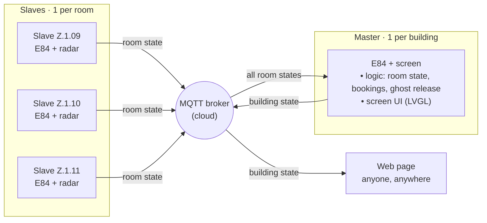
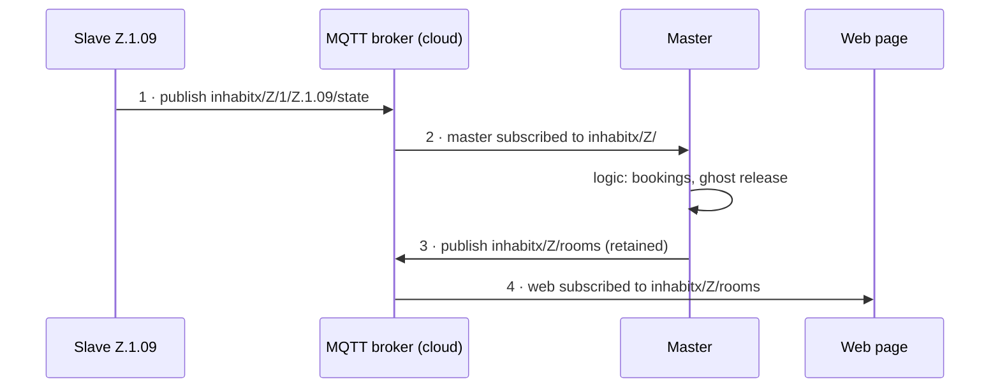
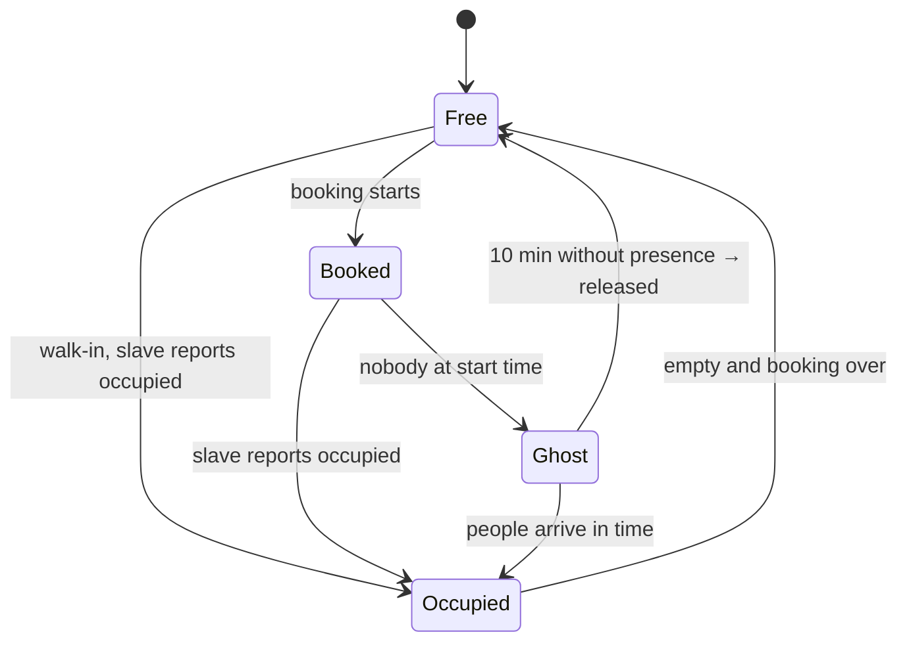
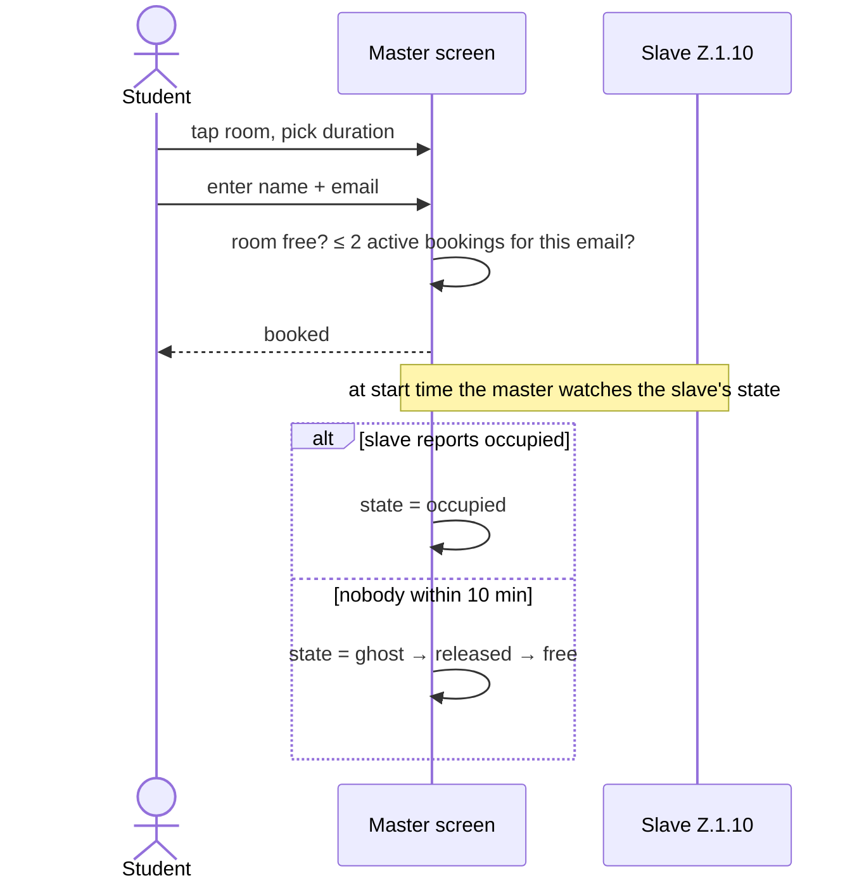

# InhabitX — Smart Campus Room Assistant

> **Challenge 01 · Infineon · campus_compile**
> Every room senses for itself on an Infineon PSOC™ Edge E84. One master per building turns that into a live room map, on its own screen and online.

---

## 1. The problem

Students and staff struggle to find free rooms, and rooms sit empty behind **ghost bookings**: booked, but nobody shows up.

## 2. The idea

- A **slave** in every room (E84 + radar) detects whether **someone is there or not**, and sends only that.
- A **master** in every building (E84 + screen) collects all rooms, runs the logic (bookings, ghost release) and shows a room map on its **own screen**.
- The master also sends the room states **online**, so **anyone, anywhere** can see free rooms on a web page.
- Booking takes a **name + email**, with no accounts. If nobody shows up within 10 minutes, the room is **released automatically**.

---

## 3. System architecture



| Part | Hardware | Job | Shows |
|---|---|---|---|
| **Slave** | E84 + radar, 1 per room | read the sensor, decide *someone there or not*, send it | nothing (LED / e-ink later) |
| **Master** | E84 + touch screen, 1 per building | receive all slaves, run the logic, publish the building state | room map + booking on its own screen (native UI, not a web page) |
| **Web page** | any browser | read the building state | live room list, for anyone with the link |

**Design principles**
- **Privacy:** no cameras. Slaves send only `occupied: true/false`. Names and emails stay on the master and are never published online.
- **Edge first:** each slave decides on the device. Raw sensor data never leaves the room.
- **No accounts:** booking takes a name + email. The room itself checks whether you showed up.

---

## 4. Communication & hosting

All devices talk through one **MQTT broker** in the cloud. Devices **publish** messages to a topic, and whoever **subscribes** to that topic receives them. Senders and receivers never need each other's address.



### Topics and messages

| Topic | From → to | Payload |
|---|---|---|
| `inhabitx/<building>/<floor>/<room>/state` | slave → master | `{"room":"Z.1.09","occupied":true,"ts":1764237600}` |
| `inhabitx/<building>/rooms` (retained) | master → web | building state, see below |
| `inhabitx/<building>/bookings/new` | web → master | *later: online booking* |

- Slaves send every **2 s**. The master marks a room **offline** if it hears nothing for **10 s**.
- The building state is **retained**, so a web page that opens later gets the latest state immediately.

```json
{
  "ts": 1764237600,
  "rooms": [
    {"id": "Z.1.08", "state": "occupied"},
    {"id": "Z.1.09", "state": "ghost", "release_in_s": 252},
    {"id": "Z.1.10", "state": "free", "free_until": "14:00"},
    {"id": "Z.1.11", "state": "booked", "until": "11:00"},
    {"id": "Z.1.12", "state": "offline"}
  ]
}
```

Room states: `free` · `booked` (waiting for people) · `ghost` (booked, nobody there, countdown running) · `occupied` · `offline`. **No names or emails** in this message.

### Services (free tiers)

| Need | Choice | Notes |
|---|---|---|
| MQTT broker | **HiveMQ Cloud** (free tier) | alternative: EMQX Serverless. Not `test.mosquitto.org`, because anyone can send fake messages there |
| Web hosting | **Netlify** (free) | connected to this repo, so every push updates the site. Works with a private repo |
| Network for the boards | **phone hotspot** | campus Wi-Fi often needs a login page or university account, which microcontrollers can't handle |

### Broker logins

| Login | Used by | Rights |
|---|---|---|
| `devices` | slaves + master | read + write `inhabitx/#` |
| `web` | web page | **read only** `inhabitx/+/rooms` (its password is visible in the page source) |

> **TLS:** the cloud broker requires encrypted connections. Boards need the broker's root certificate in their code (the Infineon MQTT example supports this). Browsers handle it automatically over secure WebSockets. **Test this before the hackathon.**

### Plan B
- **No internet:** slaves broadcast their state over **Bluetooth LE** and the master just listens. The master's screen stays live, but the web page doesn't update.
- **Only one board:** the board is the slave. A script on a laptop plays the master so the web page still works.

---

## 5. Room lifecycle (logic on the master)



**On the slave:**
```text
present  = radar presence, debounced
occupied = true  after ~3 s of presence
occupied = false after ~2 min without presence   (demo: 20 s)
```

**On the master:**
```text
ghost    = booked AND NOT occupied after start
release  = ghost for 10 min                      (demo: 30 s)
offline  = no message from the slave for 10 s
```

---

## 6. Booking

Booking happens on the **master's screen** during the hackathon. Online booking is a later step.



**Rules**
1. Booking = name + email. No account, no confirmation.
2. Maximum 2 active bookings per email.
3. Nobody there within 10 minutes of the start → the room is released.

---

## 7. What it looks like (wireframes)

Layout only. Colours and visual style are still to be decided.

### Master screen — home
At the building entrance: live floor map, free rooms, people-count filter.

```text
┌──────────────────────────────────────────────────────────────────────────┐
│ > inhabitx · building Z                                 Wed 10:06 · live │
│ ( F0 ) [ F1 ] ( F2 ) ( F3 )                                              │
│                                                                          │
│ ┌────────────────────┬┄┄┄┄┄┄┄┄┄┄┄┄┄┄┄┄┄┄┄┐ FREE NOW                      │
│ │ Z.1.08             ┊ Z.1.09            ┊ ┌───────────────────────────┐ │
│ │                    ┊ booked · 0 people ┊ │ Z.1.10  6 seats  [ Book ] │ │
│ │ occupied           ┊ releasing 04:12   ┊ │ free until 14:00          │ │
│ ├────────────────────┴┄┄┄┄┄┄┄┄┄┄┄┄┄┄┄┄┄┄┄┤ ├┄┄┄┄┄┄┄┄┄┄┄┄┄┄┄┄┄┄┄┄┄┄┄┄┄┄┄┤ │
│ │ corridor                  you are ●    │ │ Z.1.09  may free up in 4m │ │
│ ├─────────────┬─────────────┬────────────┤ └───────────────────────────┘ │
│ │ Z.1.10      │ Z.1.11      │ Z.1.12     │                               │
│ │             │             │            │ Room for  [-] 4 [+]  people   │
│ │             │             │            │                               │
│ │ free        │ occupied    │ offline    │ Tap a room on the map         │
│ └─────────────┴─────────────┴────────────┘ to book it.                   │
│  ■ occupied  ┊ ghost  □ free  ✕ offline                                  │
└──────────────────────────────────────────────────────────────────────────┘
```

### Master screen — booking
Tap a room, pick a duration, type a name and email, done.

```text
┌──────────────────────────────────────────────────┐
│ BOOK A ROOM                                    × │
│ Z.1.10          6 seats · floor 1                │
│                                                  │
│ From now (10:06), for                            │
│ ( 30 min )  [ 1 h ]  ( 2 h )                     │
│                                                  │
│ Name                                             │
│ ┌──────────────────────────────────────────────┐ │
│ │ Yousef                                       │ │
│ └──────────────────────────────────────────────┘ │
│ Email                                            │
│ ┌──────────────────────────────────────────────┐ │
│ │ yousef@uni.example                           │ │
│ └──────────────────────────────────────────────┘ │
│                                                  │
│ [            Book Z.1.10 until 11:06           ] │
│ No account needed. If nobody shows up within     │
│ 10 min, the room is released.                    │
└──────────────────────────────────────────────────┘
```

### Web page — anyone, anywhere
View-only during the hackathon: see which rooms are free right now.

```text
┌────────────────────────────┐
│ > inhabitx                 │
│ Building Z · live          │
│                            │
│ 2 FREE · 1 MAY FREE UP     │
│ ┌──────────────────────┐   │
│ │ Z.1.10   free        │   │
│ │ F1 · 6 · until 14:00 │   │
│ ├──────────────────────┤   │
│ │ Z.1.12   free        │   │
│ │ F1 · 4 · all day     │   │
│ ├┄┄┄┄┄┄┄┄┄┄┄┄┄┄┄┄┄┄┄┄┄┄┤   │
│ │ Z.1.09   ghost       │   │
│ │ frees in 4 min       │   │
│ ├──────────────────────┤   │
│ │ Z.1.08   occupied    │   │
│ │ F1 · until 11:00     │   │
│ └──────────────────────┘   │
│                            │
│ Book at the screen in      │
│ the building entrance.     │
│                            │
└────────────────────────────┘
```

---

## 8. Hardware: what each part of the PSOC™ Edge E84 does

| Capability | Slave | Master |
|---|---|---|
| **60 GHz XENSIV™ radar** | presence, including people sitting still | – |
| **Arm Cortex-M55 + Ethos-U55 NPU** | presence detection (ML model later) | – |
| **Arm Cortex-M33** | debounce, MQTT client | logic, MQTT client, UI |
| **AIROC™ Wi-Fi / Bluetooth** | publish state (BLE as plan B) | subscribe + publish |
| **Display** | – | touch screen UI (LVGL) |

---

## 9. Hackathon demo plan

Setup: **2 E84 boards** (1 slave, 1 master) on a phone hotspot, cloud broker, web page open on a phone. A fake-slave script plays the other rooms (simulated signals are allowed).

**90-second demo script**
1. The master's screen shows floor 1. Z.1.09 is booked, nobody is there, and the countdown is running.
2. The countdown hits zero, so Z.1.09 turns **free** on the master **and** on the web page on a judge's phone.
3. Someone books it on the master's screen with name + email.
4. A teammate steps in front of the slave's radar, and the room turns **occupied** everywhere.
5. Closing line: *"No cameras, no accounts. The room checks whether you actually showed up."*

---

## 10. Scope

The one-day task breakdown, with a check for each task, is in [TASKS.md](TASKS.md).

| Hackathon day | Later |
|---|---|
| Radar presence on 1 real slave (rule-based) | ML model + people counting (DEEPCRAFT™) |
| Master: logic + screen UI + booking | Online booking from the web page |
| Web page: view-only, hosted online | LED / e-ink display on each slave |
| Fake slaves for the other rooms | Voice search, lost & found, building stats |

---

## 11. Repository structure

```text
inhabitx/
├── README.md              ← you are here
├── TASKS.md               ← one-day task breakdown with checks
├── firmware/
│   ├── slave/             ← E84 per room: radar → occupied → MQTT
│   └── master/            ← E84 per building: MQTT → logic → screen UI
├── web/                   ← web page: reads the building state from the broker
└── tools/                 ← fake slaves and test scripts
```
