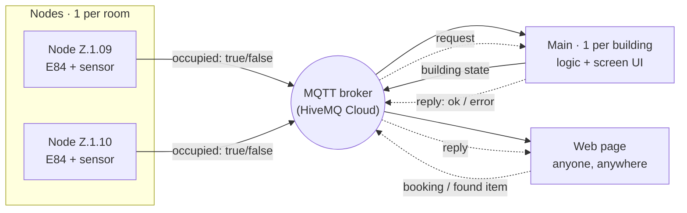
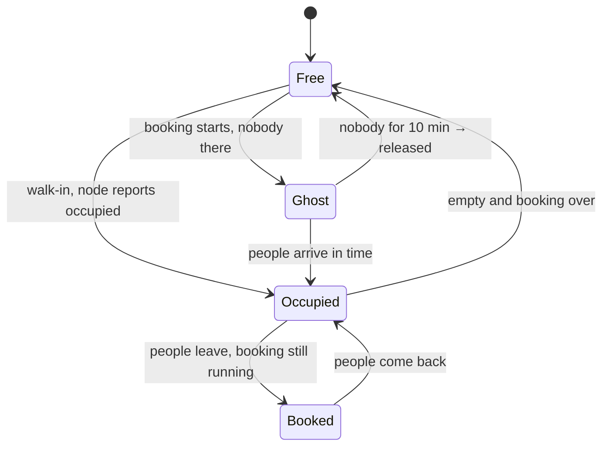

# InhabitX — Smart Campus Room Assistant

> **Challenge 01 · Infineon · campus_compile**
> Every room senses for itself on an Infineon PSOC™ Edge E84. One main per building turns that into a live room map, on its own screen and online, where anyone can also book a room.

**Live page:** https://nadaabbas444.github.io/inhabitx/ · **Tasks:** [TASKS.md](TASKS.md)

---

## 1. Problem and idea

Students and staff struggle to find free rooms, and rooms sit empty behind **ghost bookings**: booked, but nobody shows up.

- A **node** in every room (E84 + presence sensor) decides on the device whether **someone is there or not**, and sends only that.
- A **main** per building (E84 + touch screen) collects all rooms, runs the logic and shows a live room map at the entrance.
- The main also publishes the room states **online**, so anyone with the link can see free rooms **and book one**.
- Booking takes a **name + email**, no account. If nobody shows up within 10 minutes, the room is **released automatically**.
- **Lost & found:** found items are logged per room, on the screen or online.

**Privacy:** no cameras, and no raw sensor data leaves the room. Names and emails only travel to the main and are never published.

---

## 2. How it works



| Part | Hardware | Job | Now |
|---|---|---|---|
| **Node** | E84 + presence sensor (chosen in N1), 1 per room | sense, decide *someone there or not*, publish it every 2 s | the live-lab board for one room (Z.1.09), `tools/fake_nodes.py` for the rest |
| **Main** | E84 + touch screen, 1 per building | receive all nodes, bookings, ghost release, publish the building state, answer requests | the laptop: `firmware/main/sim` runs the real screen UI and logic in a window |
| **Web page** | any browser | live rooms, booking, lost & found | GitHub Pages |

The laptop must stay on while people use the link. Only **one** main may run per building.

---

## 3. Messages

All parts talk through one MQTT broker. This table is the contract between node, main and web page; change it only together.

| Topic | From → to | Payload |
|---|---|---|
| `inhabitx/Z/<floor>/<room>/state` | node → main | `{"room":"Z.1.09","occupied":true,"ts":1764237600}` every 2 s, not retained |
| `inhabitx/Z/rooms` (retained) | main → web | building state, below |
| `inhabitx/Z/lostfound` (retained) | main → web | `{"ts":…,"items":[{"room":"Z.1.10","cat":"umbrella","ts":…,"online":false}]}` |
| `inhabitx/Z/bookings/new` | web → main | `{"req":"k3j9x0a1","room":"Z.1.10","from":"14:00","to":"15:00","people":4,"name":"…","email":"…"}` |
| `inhabitx/Z/lostfound/new` | web → main | `{"req":"p0c7m2zz","room":"Z.1.11","cat":"keys"}` |
| `inhabitx/Z/replies/<req>` | main → web | `{"ok":true}` or `{"ok":false,"error":"overlap"}`, not retained |

Building state:
```json
{"ts": 1764237600, "rooms": [
  {"id": "Z.1.08", "state": "occupied", "until": "11:00"},
  {"id": "Z.1.09", "state": "ghost", "release_in_s": 252, "until": "11:00"},
  {"id": "Z.1.10", "state": "free", "free_until": "14:00", "seats": 6, "floor": 1, "slots": [["14:00", "15:00"]]},
  {"id": "Z.1.12", "state": "offline"}
]}
```

- Room states: `free` · `booked` (people checked in, room empty right now) · `ghost` (booked, nobody came, countdown running) · `occupied` · `offline`. `slots` are today's booked times; a booking until midnight ends at `"24:00"`. **No names or emails.**
- If the main drops off, the broker publishes its last will on `inhabitx/Z/rooms`: every room `offline` and `"main":"offline"`. The page then shows "Building offline".
- A room is `offline` when its node has sent nothing for **10 s**.
- `req` is a random id from the web page, which waits **8 s** for the reply.
- `error`: `name email time seats overlap busy limit full` for bookings, `room cat full` for found items.
- `cat`: `phone keys wallet bag bottle clothing electronics umbrella glasses other`. Found item `online: true` = reported on the web, not yet at the desk. Items are kept 7 days.

---

## 4. Room lifecycle



| Where | Rule |
|---|---|
| node | `occupied = true` after ~3 s of presence, `false` after ~2 min without (demo: 20 s) |
| main | ghost = booking running and nobody checked in; released after 10 min (demo build: 30 s) |
| main | offline = no node message for 10 s |

---

## 5. Booking rules

Same rules on the screen and on the web page, checked by the main:

1. Name + email, no account, no confirmation.
2. At most 2 active bookings per email.
3. Nobody there within 10 minutes of the start → released.
4. Today only, 08:00–24:00, at most 4 hours, in 15-minute steps.
5. No answer from the main within 8 s → the page says so and nothing is booked.

---

## 6. Running it

```bash
cmake -S firmware/main/sim -B firmware/main/sim/build -DGHOST_RELEASE_S=600
cmake --build firmware/main/sim/build -j
./firmware/main/sim/build/main_sim                    # the main, needs sim/broker.conf
```
```bash
python3 -m venv .venv && .venv/bin/pip install -r tools/requirements.txt
.venv/bin/python tools/fake_nodes.py --shuffle 3          # rooms without hardware
```

Details: [main simulator](firmware/main/sim/README.md) · [fake nodes](tools/README.md) · [node firmware](firmware/node/README.md) · [web page](web/README.md). `main_sim --offline` runs without a broker.

---

## 7. Services and logins

| Need | Choice | Notes |
|---|---|---|
| MQTT broker | HiveMQ Cloud Starter | `inhabitx-46341c9d.a03.euc1.aws.hivemq.cloud`, TLS on `8883`, WebSocket `8884/mqtt`. **Trial ends 12 Dec 2026: cancel before, or it costs ~$249/month** |
| Web hosting | GitHub Pages | publishes `web/` on every push to `main` |
| Network for the boards | phone hotspot | campus Wi-Fi needs a login page the boards can't handle |

| Login | Used by | Rights |
|---|---|---|
| `devices` | nodes + main | read + write `inhabitx/#` |
| `web` | web page, reading | read `inhabitx/+/rooms`, `inhabitx/+/lostfound` |
| `webhook` | web page, sending | write `inhabitx/+/bookings/new`, `inhabitx/+/lostfound/new`; read `inhabitx/+/replies/#` |

The `devices` password stays in local files that aren't committed. The two web passwords are public in the page source by design: `webhook` can't read anyone's booking, and the main's rules (2 bookings per email, 10-minute release) limit fake requests.


---

## 8. Demo (90 seconds)

Laptop as main on a big screen, the live board as the node for Z.1.09, fake nodes for the other rooms, the web page on the judges' phones.

1. Z.1.09 is booked, nobody is there, the countdown runs on the screen.
2. It hits zero: Z.1.09 turns **free** on the screen **and** on a judge's phone.
3. A judge books it from the link on their own phone; it turns booked on the screen.
4. Someone is detected by the node's sensor: the room turns **occupied** everywhere.
5. *"No cameras, no accounts. The room checks whether you actually showed up."*

---

## 9. Scope

| Hackathon day | Later |
|---|---|
| Presence on the live board (rule-based) | ML model + people counting (DEEPCRAFT™) |
| Main on the laptop: logic, screen UI, booking, lost & found | Main on its own E84 + screen per building |
| Web page: live rooms, booking, lost & found | LED / e-ink display on each node |
| Fake nodes for the other rooms | Booking confirmation emails, building stats |

---

## 10. Repository

```text
inhabitx/
├── TASKS.md            one-day task breakdown with checks
├── firmware/
│   ├── node/          E84 per room: sensor → occupied → MQTT (start here for the node)
│   └── main/
│       ├── logic/      plain C: rooms, bookings, ghost release, lost & found, messages
│       ├── ui/         LVGL screen UI
│       ├── assets/     generators for the floor plan, campus map, fonts
│       └── sim/        runs the main on a Linux laptop, MQTT
├── web/                web page (GitHub Pages)
└── tools/              fake nodes
```
