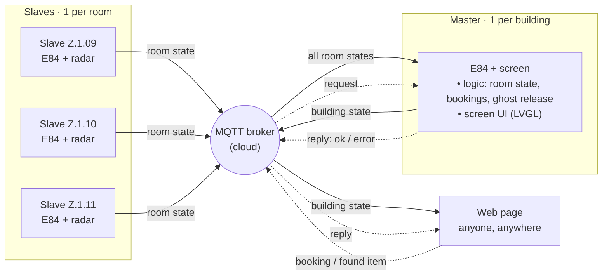
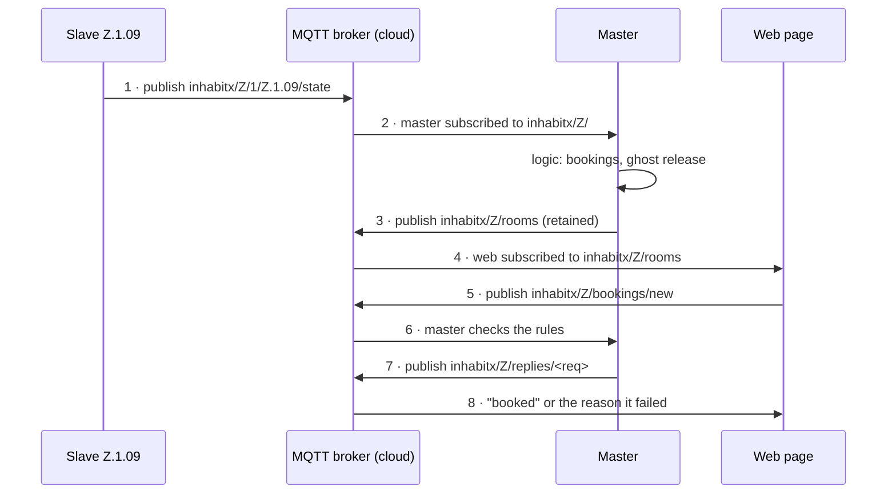
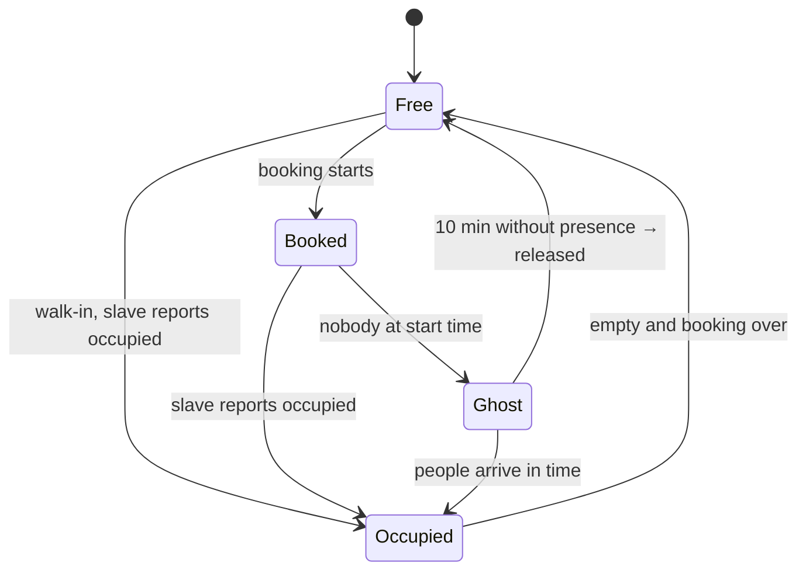
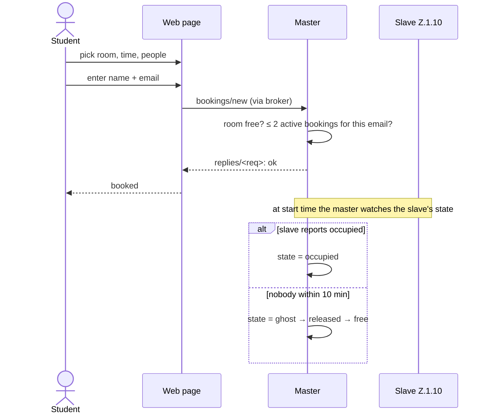

# InhabitX — Smart Campus Room Assistant

> **Challenge 01 · Infineon · campus_compile**
> Every room senses for itself on an Infineon PSOC™ Edge E84. One master per building turns that into a live room map, on its own screen and online, where anyone can also book a room.

---

## 1. The problem

Students and staff struggle to find free rooms, and rooms sit empty behind **ghost bookings**: booked, but nobody shows up.

## 2. The idea

- A **slave** in every room (E84 + radar) detects whether **someone is there or not**, and sends only that.
- A **master** in every building (E84 + screen) collects all rooms, runs the logic (bookings, ghost release) and shows a room map on its **own screen**.
- The master also sends the room states **online**, so **anyone, anywhere** can see free rooms on a web page **and book one** from a shared link.
- Booking takes a **name + email**, with no accounts, on the screen or on the web page. If nobody shows up within 10 minutes, the room is **released automatically**.
- **Lost & found:** found items are logged per room (on the screen or the web page), so people can look up where their things turned up.

---

## 3. System architecture



| Part | Hardware | Job | Shows |
|---|---|---|---|
| **Slave** | E84 + radar, 1 per room | read the sensor, decide *someone there or not*, send it | nothing (LED / e-ink later) |
| **Master** | E84 + touch screen, 1 per building | receive all slaves, run the logic, answer booking requests, publish the building state | room map + booking + lost & found on its own screen (native LVGL UI, not a web page) |
| **Web page** | any browser | read the building state, send bookings and found items | live rooms, booking, lost & found, for anyone with the link |

### What runs where right now

We have **no board in hand**, only **one remote board** in the Infineon live lab. So:

| Part | Now | Once the live board is set up |
|---|---|---|
| **Master** | the laptop: the PC simulator (`firmware/master/sim`) + MQTT. It shows the real screen UI in a window and must stay running while people use the link | the same `logic/` + `ui/` code on an E84 |
| **Slaves** | fake slaves | the live board's radar for one room, fake slaves for the rest |
| **Web page** | Netlify | Netlify |

The live board can play **one** role. Default: **slave**, because the radar is what only the E84 can do, while the master already runs on the laptop. This is decided in P0, once we know what the live lab allows (internet, screen, radar). A remote radar sees people at the lab, not in our room, so for the demo our room's presence comes from the fake slaves or from someone at the lab.

**Design principles**
- **Privacy:** no cameras. Slaves send only `occupied: true/false`. Names and emails go from the web page to the master on a topic only the master can read, are stored only on the master, and are never published back.
- **Edge first:** each slave decides on the device. Raw sensor data never leaves the room.
- **No accounts:** booking takes a name + email. The room itself checks whether you showed up.

---

## 4. Communication & hosting

All devices talk through one **MQTT broker** in the cloud. Devices **publish** messages to a topic, and whoever **subscribes** to that topic receives them. Senders and receivers never need each other's address.



### Topics and messages

| Topic | From → to | Payload |
|---|---|---|
| `inhabitx/<building>/<floor>/<room>/state` | slave → master | `{"room":"Z.1.09","occupied":true,"ts":1764237600}` |
| `inhabitx/<building>/rooms` (retained) | master → web | building state, see below |
| `inhabitx/<building>/lostfound` (retained) | master → web | found items, see below |
| `inhabitx/<building>/bookings/new` | web → master | `{"req":"k3j9x0a1","room":"Z.1.10","from":"14:00","to":"15:00","people":4,"name":"Yousef","email":"yousef@uni.example"}` |
| `inhabitx/<building>/lostfound/new` | web → master | `{"req":"p0c7m2zz","room":"Z.1.11","cat":"keys"}` |
| `inhabitx/<building>/replies/<req>` | master → web | `{"ok":true}` or `{"ok":false,"error":"overlap"}` |

- Slaves send every **2 s**. The master marks a room **offline** if it hears nothing for **10 s**.
- The building state and found items are **retained**, so a web page that opens later gets the latest state immediately. Requests and replies are **not** retained.
- `req` is a random id the web page makes up. The page waits for its reply for 8 s, then gives up.
- `error` is one of `name email time seats overlap busy limit full`, the same as `ix_book_err_t` in `firmware/master/logic/ix_model.h`.
- `cat` is one of `phone keys wallet bag bottle clothing electronics umbrella glasses other`.

```json
{
  "ts": 1764237600,
  "rooms": [
    {"id": "Z.1.08", "state": "occupied"},
    {"id": "Z.1.09", "state": "ghost", "release_in_s": 252},
    {"id": "Z.1.10", "state": "free", "free_until": "14:00",
     "seats": 6, "floor": 1, "slots": [["14:00", "15:00"]]},
    {"id": "Z.1.11", "state": "booked", "until": "11:00"},
    {"id": "Z.1.12", "state": "offline"}
  ]
}
```

Room states: `free` · `booked` (waiting for people) · `ghost` (booked, nobody there, countdown running) · `occupied` · `offline`. `seats`, `floor` and `slots` (today's booked times) are optional. **No names or emails** in this message.

```json
{"ts": 1764237600, "items": [{"room": "Z.1.10", "cat": "umbrella", "ts": 1764234000, "online": false}]}
```

Found items: `online: true` means reported on the web and not yet confirmed at the screen. Items older than 7 days are dropped.

### Services

| Need | Choice | Notes |
|---|---|---|
| MQTT broker | **HiveMQ Cloud Starter**, 15-day free trial until **12 Dec 2026** | broker `inhabitx-46341c9d.a03.euc1.aws.hivemq.cloud` (Frankfurt): MQTT over TLS on `8883`, secure WebSocket on `8884/mqtt`. HiveMQ no longer has a free hosted plan. **Cancel the trial or delete the broker before 12 Dec**, or it costs ~$249/month. Free alternative: EMQX Serverless. Not `test.mosquitto.org`, because anyone can send fake messages there |
| Web hosting | **Netlify** (free) | connected to this repo, so every push updates the site. Works with a private repo |
| Network for the boards | **phone hotspot** | campus Wi-Fi often needs a login page or university account, which microcontrollers can't handle |

### Broker logins

| Login | Used by | Rights |
|---|---|---|
| `devices` | slaves + master | read + write `inhabitx/#` |
| `web` | web page, reading | **read only** `inhabitx/+/rooms` and `inhabitx/+/lostfound` |
| `webhook` | web page, sending | **write only** `inhabitx/+/bookings/new` and `inhabitx/+/lostfound/new`, **read only** `inhabitx/+/replies/#` |

Both web passwords are visible in the page source. That's acceptable because:
- `webhook` can't read `bookings/new`, so nobody can see other people's names and emails.
- Fake requests are limited by the master's rules: max 2 active bookings per email, and an unused booking is released 10 minutes after its start. Found items reported online are marked as not yet confirmed.

Each login is limited to its topics through HiveMQ permissions and roles (roles `devices`, `web`, `webbook`). Passwords are never committed except the two web ones, which have to be in the public page anyway.

> **TLS:** the cloud broker requires encrypted connections. Boards need the broker's root certificate in their code (the Infineon MQTT example supports this). Browsers handle it automatically over secure WebSockets. **Test this before the hackathon.**

### Plan B
- **No internet:** slaves broadcast their state over **Bluetooth LE** and the master just listens. The master's screen stays live, but the web page doesn't update.
- **Live board can't reach the internet:** the laptop stays the master, fake slaves play every room, and the live board is shown on its own (radar output, screen UI).

---

## 5. Room lifecycle (logic on the master)



**On the slave:**
```text
present  = radar presence, debounced
occupied = true  after ~3 s of presence
occupied = false after ~2 min without presence   (demo: 20 s)
```

**On the master:**
```text
ghost    = booked AND NOT occupied after start
release  = ghost for 10 min                      (demo: 30 s)
offline  = no message from the slave for 10 s
```

---

## 6. Booking

Booking works on the **master's screen** and on the **web page**. Both go through the same rules on the master. Booking from the web page:



**Rules**
1. Booking = name + email. No account, no confirmation.
2. Maximum 2 active bookings per email.
3. Nobody there within 10 minutes of the start → the room is released.
4. Today only, between 07:00 and 22:00, at most 4 hours, in 15-minute steps.
5. If the master doesn't answer within 8 s (e.g. the laptop is off), the web page says so and nothing is booked.

---

## 7. What it looks like (wireframes)

Early layout sketches. The real screen UI is in `firmware/master/ui` (1024×600, run it with the simulator) and the real web page is `web/index.html`. Colours and visual style are still to be decided.

### Master screen — home
At the building entrance: live floor map, free rooms, people-count filter.

```text
┌──────────────────────────────────────────────────────────────────────────┐
│ > inhabitx · building Z                                 Wed 10:06 · live │
│ ( F0 ) [ F1 ] ( F2 ) ( F3 )                                              │
│                                                                          │
│ ┌────────────────────┬┄┄┄┄┄┄┄┄┄┄┄┄┄┄┄┄┄┄┄┐ FREE NOW                      │
│ │ Z.1.08             ┊ Z.1.09            ┊ ┌───────────────────────────┐ │
│ │                    ┊ booked · 0 people ┊ │ Z.1.10  6 seats  [ Book ] │ │
│ │ occupied           ┊ releasing 04:12   ┊ │ free until 14:00          │ │
│ ├────────────────────┴┄┄┄┄┄┄┄┄┄┄┄┄┄┄┄┄┄┄┄┤ ├┄┄┄┄┄┄┄┄┄┄┄┄┄┄┄┄┄┄┄┄┄┄┄┄┄┄┄┤ │
│ │ corridor                  you are ●    │ │ Z.1.09  may free up in 4m │ │
│ ├─────────────┬─────────────┬────────────┤ └───────────────────────────┘ │
│ │ Z.1.10      │ Z.1.11      │ Z.1.12     │                               │
│ │             │             │            │ Room for  [-] 4 [+]  people   │
│ │             │             │            │                               │
│ │ free        │ occupied    │ offline    │ Tap a room on the map         │
│ └─────────────┴─────────────┴────────────┘ to book it.                   │
│  ■ occupied  ┊ ghost  □ free  ✕ offline                                  │
└──────────────────────────────────────────────────────────────────────────┘
```

### Master screen — booking
Tap a room, pick a duration, type a name and email, done.

```text
┌──────────────────────────────────────────────────┐
│ BOOK A ROOM                                    × │
│ Z.1.10          6 seats · floor 1                │
│                                                  │
│ From now (10:06), for                            │
│ ( 30 min )  [ 1 h ]  ( 2 h )                     │
│                                                  │
│ Name                                             │
│ ┌──────────────────────────────────────────────┐ │
│ │ Yousef                                       │ │
│ └──────────────────────────────────────────────┘ │
│ Email                                            │
│ ┌──────────────────────────────────────────────┐ │
│ │ yousef@uni.example                           │ │
│ └──────────────────────────────────────────────┘ │
│                                                  │
│ [            Book Z.1.10 until 11:06           ] │
│ No account needed. If nobody shows up within     │
│ 10 min, the room is released.                    │
└──────────────────────────────────────────────────┘
```

### Web page — anyone, anywhere
See which rooms are free right now, book one, or report a found item.

```text
┌────────────────────────────┐
│ > inhabitx                 │
│ Building Z · live          │
│                            │
│ 2 FREE · 1 MAY FREE UP     │
│ ┌──────────────────────┐   │
│ │ Z.1.10   free        │   │
│ │ F1 · 6 · until 14:00 │   │
│ ├──────────────────────┤   │
│ │ Z.1.12   free        │   │
│ │ F1 · 4 · all day     │   │
│ ├┄┄┄┄┄┄┄┄┄┄┄┄┄┄┄┄┄┄┄┄┄┄┤   │
│ │ Z.1.09   ghost       │   │
│ │ frees in 4 min       │   │
│ ├──────────────────────┤   │
│ │ Z.1.08   occupied    │   │
│ │ F1 · until 11:00     │   │
│ └──────────────────────┘   │
│                            │
│ [ Book a room ]            │
│ [ Report a found item ]    │
│                            │
└────────────────────────────┘
```

---

## 8. Hardware: what each part of the PSOC™ Edge E84 does

| Capability | Slave | Master |
|---|---|---|
| **60 GHz XENSIV™ radar** | presence, including people sitting still | – |
| **Arm Cortex-M55 + Ethos-U55 NPU** | presence detection (ML model later) | – |
| **Arm Cortex-M33** | debounce, MQTT client | logic, MQTT client, UI |
| **AIROC™ Wi-Fi / Bluetooth** | publish state (BLE as plan B) | subscribe + publish |
| **Display** | – | touch screen UI (LVGL) |

---

## 9. Hackathon demo plan

Setup: the **laptop as master** (simulator window on a big screen), the **remote live board** (slave, or master if the live lab allows), cloud broker, web page open on judges' phones. Fake slaves play the other rooms (simulated signals are allowed).

**90-second demo script**
1. The master's screen shows floor 1. Z.1.09 is booked, nobody is there, and the countdown is running.
2. The countdown hits zero, so Z.1.09 turns **free** on the master **and** on the web page on a judge's phone.
3. A judge books it **from the link on their own phone** with name + email, and it turns booked on the master's screen.
4. A teammate steps in front of the slave's radar, and the room turns **occupied** everywhere.
5. Closing line: *"No cameras, no accounts. The room checks whether you actually showed up."*

---

## 10. Scope

The one-day task breakdown, with a check for each task, is in [TASKS.md](TASKS.md).

| Hackathon day | Later |
|---|---|
| Radar presence on the live board (rule-based) | ML model + people counting (DEEPCRAFT™) |
| Master: logic + screen UI + booking + lost & found, on the laptop | Master on its own E84 + screen per building |
| Web page: live rooms, booking, lost & found, hosted online | LED / e-ink display on each slave |
| Fake slaves for the other rooms | Voice search, building stats, booking confirmation emails |

---

## 11. Repository structure

```text
inhabitx/
├── README.md              ← you are here
├── TASKS.md               ← one-day task breakdown with checks
├── firmware/
│   ├── slave/             ← E84 per room: radar → occupied → MQTT
│   └── master/            ← per building: MQTT → logic → screen UI
│       ├── logic/         ← plain C: rooms, bookings, ghost release, lost & found
│       ├── ui/            ← LVGL screen UI
│       ├── assets/        ← generators for the floor plan, campus map, fonts
│       └── sim/           ← runs the master on a Linux laptop
├── web/                   ← web page: live rooms, booking, lost & found
└── tools/                 ← fake slaves and test scripts
```
