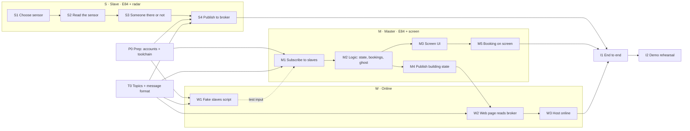

# InhabitX — One-day task breakdown

Each task ends with a **check** the other person can run in a few minutes to review it.

| Track | Hardware | Owner |
|---|---|---|
| **S · Slave** | E84 + radar, in the room | mechatronics |
| **M · Master** | E84 + screen, at the building entrance | _to decide_ |
| **W · Online** | broker, web page, test tools | software |

Priority: 🔴 must have for the demo · 🟡 should have · ⚪ stretch

---

## Dependency map

- **T0 is the only thing everybody waits on.** After that the three tracks run in parallel.
- **The fake slaves (W1)** let the master be built and tested before the real slave works.
- **The master and the web page** can be tested against the broker's web console by publishing a message by hand.

---

## Overview

| ID | Task | Track | Prio | Depends on |
|---|---|---|---|---|
| P0 | Prep: accounts + toolchain | all | 🔴 | – |
| T0 | Topics + message format | all | 🔴 | – |
| S1 | Choose sensor | S | 🔴 | – |
| S2 | Read the sensor | S | 🔴 | S1 |
| S3 | Someone there or not | S | 🔴 | S2 |
| S4 | Publish to broker | S | 🔴 | S3, T0, P0 |
| M1 | Subscribe to slaves | M | 🔴 | T0, P0 |
| M2 | Logic: state, bookings, ghost release | M | 🔴 | M1 |
| M3 | Screen UI | M | 🔴 | M2 |
| M4 | Publish building state | M | 🔴 | M2 |
| M5 | Booking on screen | M | 🟡 | M3 |
| W1 | Fake slaves script | W | 🔴 | T0, P0 |
| W2 | Web page reads broker | W | 🔴 | T0 (M4 for real data) |
| W3 | Host online | W | 🟡 | W2 |
| I1 | End to end | all | 🔴 | S4, M5, W3 |
| I2 | Demo rehearsal | all | 🔴 | I1 |

---

## P0 — Prep: accounts + toolchain 🔴 (before the day)

- [ ] **HiveMQ Cloud** free account. Create logins `devices` (read + write `inhabitx/#`) and `web` (read only `inhabitx/+/rooms`)
- [ ] **Netlify** free account, connected to this repo, publishing the `web/` folder
- [ ] **ModusToolbox** installed. Build and flash the Infineon **Wi-Fi MQTT client** example on one board and connect it to HiveMQ **with TLS** (root certificate)
- [ ] **Phone hotspot** name + password decided for all boards
- [ ] Ask the organisers: are the boards physically available, or only remote via `infineon-live-lab`? Can they reach the internet?

**Check:** a board publishes a test message and it shows up in the HiveMQ web console.

---

## T0 — Topics + message format 🔴 (together, first thing)

Write [README §4](README.md#4-communication--hosting) down as the contract and don't change it without telling each other.

| Topic | Payload |
|---|---|
| `inhabitx/Z/1/<room>/state` | `{"room":"Z.1.09","occupied":true,"ts":1764237600}` every 2 s |
| `inhabitx/Z/rooms` (retained) | `{"ts":…,"rooms":[{"id":"Z.1.09","state":"ghost","release_in_s":252}, …]}` |

**Check:** everyone can publish a valid example message by hand in the HiveMQ console.

---

## S · Slave (E84 + radar)

### S1 — Choose sensor 🔴
Compare the radar on the E84 kit with at least one alternative (and PIR as the baseline). What matters most: does it detect a **person sitting still**? Also check range, field of view and where it would be mounted.

**Check:** a short note in `firmware/slave/README.md` with the choice and the reason.

### S2 — Read the sensor 🔴
Get the radar running on the board and print its output over USB.

**Check:** the values visibly change when someone moves in front of the board.

### S3 — Someone there or not 🔴
Turn the raw values into `occupied: true/false`:
- `true` after ~3 s of presence
- `false` only after **2 min** without presence (demo: **20 s**), so a person sitting still doesn't "disappear"

| Scenario | Must show |
|---|---|
| empty room | `false` |
| 1 person sitting still for 1 min | `true` the whole time |
| 1 person moving | `true` |
| someone walking past at a distance | `false` |

**Check:** the reviewer runs all 4 scenarios and they pass.

### S4 — Publish to broker 🔴
Send the T0 message every 2 s over Wi-Fi to HiveMQ (start from the MQTT example from P0).

**Check:** the messages show up in the HiveMQ console, and `occupied` changes when someone walks in and out.

---

## M · Master (E84 + screen)

### M1 — Subscribe to slaves 🔴
Connect to HiveMQ and subscribe to `inhabitx/Z/#`. Keep the latest state and time per room.

**Check:** with the fake slaves (W1) running, the master prints every room's state, and a room with no message for 10 s shows as `offline`.

### M2 — Logic: state, bookings, ghost release 🔴
In C on the master:
- list of rooms with their state (see README §5)
- bookings: room, start, end, name, email. Reject overlaps and a 3rd active booking per email
- ghost rule: booked + not occupied → `ghost` → released after **10 min** (demo: **30 s**)

**Check:** with fake slaves, 3 cases:
1. booking, nobody there → released after the timeout
2. booking, slave goes `occupied` before the timeout → not released
3. 3rd booking with the same email → rejected

### M3 — Screen UI 🔴
LVGL on the master's display, starting from an Infineon display example. Floor map + "free now" list (see README §7). Updates live.

**Check:** a fake slave changes state → the screen updates within 2 s.

### M4 — Publish building state 🔴
Publish the building state to `inhabitx/Z/rooms` (retained) every time something changes. No names or emails.

**Check:** the message appears in the HiveMQ console and matches what the screen shows.

### M5 — Booking on screen 🟡
Tap a room → pick 30 / 60 min → name + email on the on-screen keyboard → book.

**Check:** book a room on the screen → it shows as `booked` on the screen and on the web page.
_If time runs out:_ hard-code a demo booking at start-up.

---

## W · Online

### W1 — Fake slaves script 🔴
`tools/fake_slaves.py` publishes T0 messages for rooms without hardware (Z.1.08, Z.1.10, Z.1.11, Z.1.12). Options: `--room Z.1.09 --occupied false` to control one room by hand during tests.

**Check:** the messages show up in the HiveMQ console in the right format.

### W2 — Web page reads broker 🔴
`web/index.html` with `mqtt.js`, connects with the **read-only** `web` login over secure WebSockets and subscribes to `inhabitx/Z/rooms`. Shows the room list (see README §7). Before M4 is ready, test it by publishing a building-state message by hand in the HiveMQ console.

**Check:** a building-state message published by hand → the page updates within 2 s. Works on a phone.

### W3 — Host online 🟡
Netlify serves `web/`. Every push to `main` updates the site.

**Check:** the link opens on a phone **on mobile data** (not the hotspot) and shows live rooms.

---

## Integration

### I1 — End to end 🔴
Real slave + master + web page, with fake slaves for the other rooms.

**Check:**
- walk in front of the slave → occupied on the master screen **and** the web page in < 5 s
- book a room, nobody comes → released after 30 s everywhere
- switch the slave off → `offline` after 10 s

### I2 — Demo rehearsal 🔴
The 90-second script from README §9.

**Check:** it runs **3 times in a row** without a restart. Record one run as a backup video.

---

## If you're behind

Cut in this order. The demo still works after each cut.
1. **M5** → a booking hard-coded at start-up
2. **W3** → open `web/index.html` locally on a laptop with internet
3. **Real slave in I1** → `fake_slaves.py --room Z.1.09` controlled by hand
