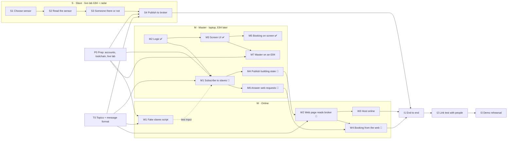

# InhabitX — One-day task breakdown

Each task ends with a **check** the other person can run in a few minutes to review it.

| Track | Hardware | Owner |
|---|---|---|
| **S · Slave** | remote live-lab E84 + radar | mechatronics |
| **M · Master** | laptop now (simulator + MQTT), an E84 later | software |
| **W · Online** | broker, web page, test tools | software |

Priority: 🔴 must have for the demo · 🟡 should have · ⚪ stretch
Status: ✅ done · 🔶 built, not yet tested against the broker · blank = to do

We have **no board in hand**, only one remote board in the Infineon live lab (README §3).

---

## Dependency map

- **T0 and P0 are what everybody waits on.** After that the tracks run in parallel.
- **M1 is the key open task:** it connects the finished master to the broker. Without it, the web page and the link can't work.
- **The fake slaves (W1)** let the master be tested before the real slave works.
- **M7 is only needed if the live board becomes the master.** Otherwise the laptop stays the master.

---

## Overview

| ID | Task | Track | Prio | Status | Depends on |
|---|---|---|---|---|---|
| P0 | Prep: accounts, toolchain, live lab | all | 🔴 | | – |
| T0 | Topics + message format | all | 🔴 | | – |
| S1 | Choose sensor | S | 🔴 | | – |
| S2 | Read the sensor | S | 🔴 | | S1, P0 (live lab) |
| S3 | Someone there or not | S | 🔴 | | S2 |
| S4 | Publish to broker | S | 🔴 | | S3, T0, P0 |
| M1 | Subscribe to slaves | M | 🔴 | 🔶 | M2, T0, P0 |
| M2 | Logic: state, bookings, ghost release | M | 🔴 | ✅ | – |
| M3 | Screen UI | M | 🔴 | ✅ in the simulator | M2 |
| M4 | Publish building state + found items | M | 🔴 | 🔶 | M1 |
| M5 | Booking on screen | M | 🟡 | ✅ in the simulator | M3 |
| M6 | Answer web requests | M | 🔴 | 🔶 | M1 |
| M7 | Master on an E84 | M | ⚪ | | M3, M1, P0 (live lab) |
| W1 | Fake slaves script | W | 🔴 | | T0, P0 |
| W2 | Web page reads broker | W | 🔴 | 🔶 demo mode | T0 (M4 for real data) |
| W3 | Host online | W | 🔴 | ✅ | W2 |
| W4 | Booking + found items from the web | W | 🔴 | 🔶 demo mode | W2, M6 |
| I1 | End to end | all | 🔴 | | S4, W3, W4 |
| I2 | Link test with people | all | 🟡 | | I1 |
| I3 | Demo rehearsal | all | 🔴 | | I1 |

---

## P0 — Prep: accounts, toolchain, live lab 🔴 (before the day)

- [x] **HiveMQ Cloud** broker (Starter trial, ends 12 Dec 2026) with the three logins from README §4: `devices`, `web`, `webhook`, each limited to its topics
- [x] Connection tested: connect with `devices`, publish a test message, see it arrive
- [ ] Reminder set to cancel the HiveMQ trial before 12 Dec 2026
- [x] Repo **public** and **GitHub Pages** on (Settings → Pages → Source: GitHub Actions)
- [ ] **ModusToolbox** installed on the laptop
- [ ] **Live lab:** how do we get our code onto the board? Does it have internet (to reach HiveMQ)? Can we see and touch its screen? Does it have the radar? Is it ours all day or in time slots?
- [ ] Decide the live board's role: slave (default) or master
- [ ] Passwords go into local config files that aren't committed, never into the repo or a chat

**Check:** the live board (or, until then, the laptop) publishes a test message and it shows up in the HiveMQ web console.

---

## T0 — Topics + message format 🔴 (together, first thing)

Write [README §4](README.md#4-communication--hosting) down as the contract and don't change it without telling each other.

| Topic | Payload |
|---|---|
| `inhabitx/Z/1/<room>/state` | `{"room":"Z.1.09","occupied":true,"ts":1764237600}` every 2 s |
| `inhabitx/Z/rooms` (retained) | `{"ts":…,"rooms":[{"id":"Z.1.09","state":"ghost","release_in_s":252}, …]}` |
| `inhabitx/Z/lostfound` (retained) | `{"ts":…,"items":[{"room":"Z.1.10","cat":"umbrella","ts":…,"online":false}]}` |
| `inhabitx/Z/bookings/new` | `{"req":"k3j9x0a1","room":"Z.1.10","from":"14:00","to":"15:00","people":4,"name":"…","email":"…"}` |
| `inhabitx/Z/lostfound/new` | `{"req":"p0c7m2zz","room":"Z.1.11","cat":"keys"}` |
| `inhabitx/Z/replies/<req>` | `{"ok":true}` or `{"ok":false,"error":"overlap"}` |

**Check:** everyone can publish a valid example message by hand in the HiveMQ console.

---

## S · Slave (E84 + radar)

### S1 — Choose sensor 🔴
Compare the radar on the E84 kit with at least one alternative (and PIR as the baseline). What matters most: does it detect a **person sitting still**? Also check range, field of view and where it would be mounted.

**Check:** a short note in `firmware/slave/README.md` with the choice and the reason.

### S2 — Read the sensor 🔴
Get the radar running on the live board and print its output (over the live lab's serial console).

**Check:** the values visibly change when someone moves in front of the board. With a remote board, ask the live-lab staff to step in front of it, or watch the lab camera if there is one.

### S3 — Someone there or not 🔴
Turn the raw values into `occupied: true/false`:
- `true` after ~3 s of presence
- `false` only after **2 min** without presence (demo: **20 s**), so a person sitting still doesn't "disappear"

| Scenario | Must show |
|---|---|
| empty room | `false` |
| 1 person sitting still for 1 min | `true` the whole time |
| 1 person moving | `true` |
| someone walking past at a distance | `false` |

**Check:** the reviewer runs all 4 scenarios and they pass. With the remote board this needs someone at the lab; if that's not possible, record the raw radar values of each scenario once and replay them.

### S4 — Publish to broker 🔴
Send the T0 message every 2 s over Wi-Fi to HiveMQ (start from the MQTT example from P0).

**Check:** the messages show up in the HiveMQ console, and `occupied` changes when someone walks in and out.

---

## M · Master (laptop now, E84 later)

The master's code is in `firmware/master`: `logic/` (plain C), `ui/` (LVGL) and `sim/` (runs both on a Linux laptop, see `firmware/master/sim/README.md`). The same `logic/` and `ui/` go onto an E84 later.

### M1 — Subscribe to slaves 🔴 🔶
Built (coreMQTT over TLS, `sim/mqtt_link.c`, messages in `logic/ix_msg.c`) and tested against a local TLS broker; still to test against HiveMQ. Setup in `firmware/master/sim/README.md`.

Add MQTT to the simulator (`sim/main.c`): connect to HiveMQ with the `devices` login (TLS), subscribe to `inhabitx/Z/#`, and call `ix_slave_update()` for every slave message. The built-in fake slaves stay available for offline tests.

**Check:** with the fake slaves script (W1) running, the simulator's screen follows it, and a room with no message for 10 s shows as `offline`.

### M2 — Logic: state, bookings, ghost release 🔴 ✅
`logic/ix_model.c`: rooms, bookings (rejects overlaps and a 3rd active booking per email), ghost release after 30 s in the demo, lost & found.

**Check:** `cd firmware/master/logic && cc -I. test_model.c ix_model.c -o t && ./t` prints `all model checks passed`.

### M3 — Screen UI 🔴 ✅ in the simulator
Floor plan, rooms list, campus map, lost & found. 1024×600.

**Check:** run the simulator, type `o 09` → Z.1.09 turns occupied within 2 s.

### M4 — Publish building state + found items 🔴 🔶
Publish `inhabitx/Z/rooms` and `inhabitx/Z/lostfound` (both retained) every time something changes. No names or emails.

**Check:** the messages appear in the HiveMQ console and match what the screen shows.

### M5 — Booking on screen 🟡 ✅ in the simulator
**Check:** book a room in the simulator → it shows as `booked` on the screen (and on the web page once M4 works).

### M6 — Answer web requests 🔴 🔶
Subscribe to `bookings/new` and `lostfound/new`. Run them through `ix_book()` / `ix_found_add()` and publish the answer to `replies/<req>`. Never log or republish names and emails.

**Check:** publish a booking request by hand in the HiveMQ console → a reply appears and the room turns booked on the screen. Send a 3rd booking with the same email → `{"ok":false,"error":"limit"}`.

### M7 — Master on an E84 ⚪
Only if the live board becomes the master: start from Infineon's LVGL display example, add `logic/` + `ui/` and the MQTT part from M1/M4/M6. Porting notes are in `firmware/master/sim/README.md`.

**Check:** the live board's screen shows the same as the simulator.

---

## W · Online

### W1 — Fake slaves script 🔴
`tools/fake_slaves.py` publishes T0 messages for rooms without hardware (Z.1.08, Z.1.10, Z.1.11, Z.1.12). Options: `--room Z.1.09 --occupied false` to control one room by hand during tests.

**Check:** the messages show up in the HiveMQ console in the right format.

### W2 — Web page reads broker 🔴 🔶 demo mode
`web/index.html` is built and runs in demo mode. Left to do: fill in `brokerUrl` and the `web` login, then test it against HiveMQ. Before M4 is ready, test it by publishing a building-state message by hand in the HiveMQ console.

**Check:** a building-state message published by hand → the page updates within 2 s. Works on a phone.

### W3 — Host online 🔴
GitHub Pages serves `web/` at `https://nadaabbas444.github.io/inhabitx/`. Every push to `main` that changes `web/` updates the site.

**Check:** the link opens on a phone **on mobile data** (not the hotspot) and shows live rooms.

### W4 — Booking + found items from the web 🔴 🔶 demo mode
The booking and found-item forms are built. Left to do: fill in the `webhook` login and test the replies from M6.

**Check:** book from a phone → "booked" within 2 s, and the room turns booked on the master's screen. With the laptop master off → the page says it couldn't reach the master after 8 s.

---

## Integration

### I1 — End to end 🔴
Live board + laptop master + web page, with fake slaves for the other rooms.

**Check:**
- someone in front of the radar → occupied on the master screen **and** the web page in < 5 s
- book a room from a phone, nobody comes → released after 30 s everywhere
- switch the slave off → `offline` after 10 s

### I2 — Link test with people 🟡
Send the link to friends and ask them to book. The laptop master must keep running the whole time. Set the ghost release to the real 10 min for this test.

**Check:** at least 5 people booked from their own phones, and nobody saw anyone else's name or email.

### I3 — Demo rehearsal 🔴
The 90-second script from README §9.

**Check:** it runs **3 times in a row** without a restart. Record one run as a backup video.

---

## If you're behind

Cut in this order. The demo still works after each cut.
1. **M7** → the laptop stays the master
2. **W4** → book on the simulator screen only
3. **W3** → open `web/index.html` locally on a laptop with internet
4. **Real slave in I1** → fake slaves controlled by hand
